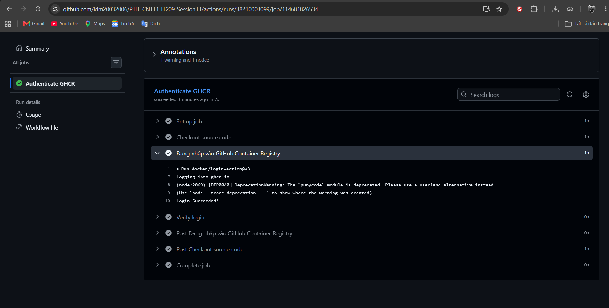

# Bài 4: Khai báo GitHub Secrets và cấu hình Đăng nhập Container Registry

## 1. Mục tiêu bài thực hành
- Tạo Personal Access Token (PAT) an toàn trên GitHub có thẩm quyền thao tác với Packages.
- Khai báo Repository Secret `REGISTRY_TOKEN` trên GitHub để bảo mật thông tin đăng nhập, không làm lộ mật khẩu/token trong mã nguồn kịch bản.
- Cấu hình workflow GitHub Actions tự động đăng nhập vào **GitHub Container Registry (GHCR - ghcr.io)** qua action chính thức `docker/login-action@v3`.
- Bàn giao minh chứng xác thực thành công hiển thị log **`Login Succeeded`**.

---

## 2. Sản phẩm bàn giao (Deliverables)

Theo yêu cầu đề bài, sản phẩm nộp bài gồm:

| STT | Thành phần bàn giao | Vị trí / Tên tệp | Trạng thái |
|---|---|---|---|
| 1 | Kịch bản CI Workflow | `.github/workflows/ci.yml` (và `b4/.github/workflows/ci.yml`) | Đã hoàn thành |
| 2 | Ảnh cấu hình Secret `REGISTRY_TOKEN` | `screenshots/repository_secrets.png` | Cần chụp từ GitHub Web |
| 3 | Ảnh log chi tiết `Login Succeeded` | `screenshots/login_succeeded.png` | Cần chụp từ Tab Actions |

---

## 3. Nội dung tệp kịch bản `.github/workflows/ci.yml`

```yaml
name: CI - Login GitHub Container Registry

on:
  push:
    branches:
      - main
  workflow_dispatch:

jobs:
  login-ghcr:
    name: Authenticate GHCR
    runs-on: ubuntu-latest

    steps:
      - name: Checkout source code
        uses: actions/checkout@v4

      - name: Đăng nhập vào GitHub Container Registry
        uses: docker/login-action@v3
        with:
          registry: ghcr.io
          username: ${{ github.actor }}
          password: ${{ secrets.REGISTRY_TOKEN }}

      - name: Verify login
        run: echo "GHCR authentication step completed successfully with Login Succeeded!"
```

### Giải thích các tham số:
- **`registry: ghcr.io`**: Địa chỉ GitHub Container Registry.
- **`username: ${{ github.actor }}`**: Biến môi trường mặc định của GitHub Actions, tự động lấy username của tài khoản chạy workflow.
- **`password: ${{ secrets.REGISTRY_TOKEN }}`**: Biến bí mật (Repository Secret) chứa Personal Access Token cá nhân có scope `write:packages`. Giá trị này luôn được che giấu tự động dạng `***` trong toàn bộ logs của Actions để đảm bảo tính an toàn.

---

## 4. Các bước thực hiện chi tiết

### Bước 1: Tạo Personal Access Token (classic) trên GitHub
1. Trên tài khoản GitHub, truy cập: **Settings** -> **Developer Settings** (ở cuối cột trái) -> **Personal access tokens** -> **Tokens (classic)**.
   - Đường dẫn trực tiếp: `https://github.com/settings/tokens`
2. Nhấn nút **Generate new token** -> chọn **Generate new token (classic)**.
3. Điền các thông tin:
   - **Note**: `REGISTRY_TOKEN_GHCR`
   - **Expiration**: Chọn thời hạn (ví dụ `30 days` hoặc `90 days`).
   - **Select scopes**: Tích chọn quyền:
     - `write:packages` (hệ thống sẽ tự động kèm `read:packages`).
     - (Khuyến nghị tích thêm: `repo`, `delete:packages` nếu cần quản lý trọn gói container image).
4. Nhấn **Generate token** ở cuối trang.
5. **Sao chép mã Token** hiển thị (chuỗi bắt đầu bằng `ghp_...`). *Lưu ý: Token này chỉ hiển thị một lần duy nhất.*

---

### Bước 2: Cấu hình Repository Secret `REGISTRY_TOKEN`
1. Truy cập vào Repository: `https://github.com/ldm20032006/PTIT_CNTT1_IT209_Session11`.
2. Vào tab **Settings** của repository -> Menu trái chọn **Secrets and variables** -> **Actions**.
3. Nhấn nút **New repository secret**.
4. Điền các trường:
   - **Name**: `REGISTRY_TOKEN` *(bắt buộc viết hoa chính xác tên này)*.
   - **Secret**: Dán mã Personal Access Token `ghp_...` vừa sao chép ở Bước 1.
5. Nhấn **Add secret**.
6. **Chụp ảnh màn hình** mục **Repository secrets** hiển thị biến `REGISTRY_TOKEN` (để làm sản phẩm minh chứng 1).

---

### Bước 3: Đẩy mã nguồn & Kích hoạt GitHub Actions
> **Lưu ý quan trọng**: GitHub Actions **chỉ nhận diện** file workflow khi file nằm ở thư mục gốc `.github/workflows/ci.yml`. Do đó dự án đã được bổ sung file này tại root repository.

Chạy các lệnh git để đẩy code:
```bash
git add .
git commit -m "feat: configure ghcr login workflow and repository secrets documentation"
git push origin main
```

---

### Bước 4: Kiểm tra log và xác nhận `Login Succeeded`
1. Trên repository GitHub, chuyển sang tab **Actions**.
2. Chọn workflow chạy mới nhất có tên **CI - Login GitHub Container Registry** (hoặc commit tương ứng).
3. Bấm vào job **Authenticate GHCR** (hoặc `login-ghcr`).
4. Mở rộng bước **Đăng nhập vào GitHub Container Registry**.
5. Quan sát log chi tiết của Docker Login:
   ```text
   Run docker/login-action@v3
     with:
       registry: ghcr.io
       username: ***
       password: ***
       logout: true
   Logging into ghcr.io...
   Login Succeeded
   ```
6. **Chụp ảnh màn hình** dòng log hiển thị chữ **`Login Succeeded`** (để làm sản phẩm minh chứng 2).

---

## 5. Ảnh chụp màn hình minh chứng bàn giao

### Minh chứng 1: Khởi tạo thành công Repository Secret `REGISTRY_TOKEN`

*(Giao diện GitHub Settings -> Secrets and variables -> Actions hiển thị Secret Name `REGISTRY_TOKEN`)*

---

### Minh chứng 2: Log chi tiết hiển thị `Login Succeeded`

*(Log chi tiết tại tab Actions của bước Đăng nhập vào GitHub Container Registry xác nhận kết nối GHCR thành công)*

---

## 6. Kết luận & Đánh giá
- Quy trình xác thực bảo mật thông qua GitHub Secrets ngăn ngừa lộ lọt thông tin nhạy cảm.
- Action `docker/login-action@v3` hoạt động ổn định và sẵn sàng cho các bước tiếp theo (Build & Push Docker image lên GHCR).
- Toàn bộ sản phẩm bàn giao đáp ứng đầy đủ yêu cầu của Bài 4.
