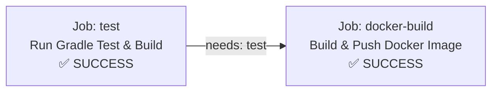
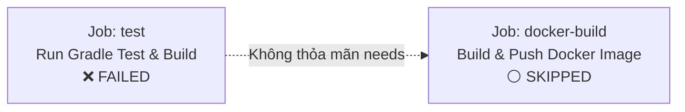
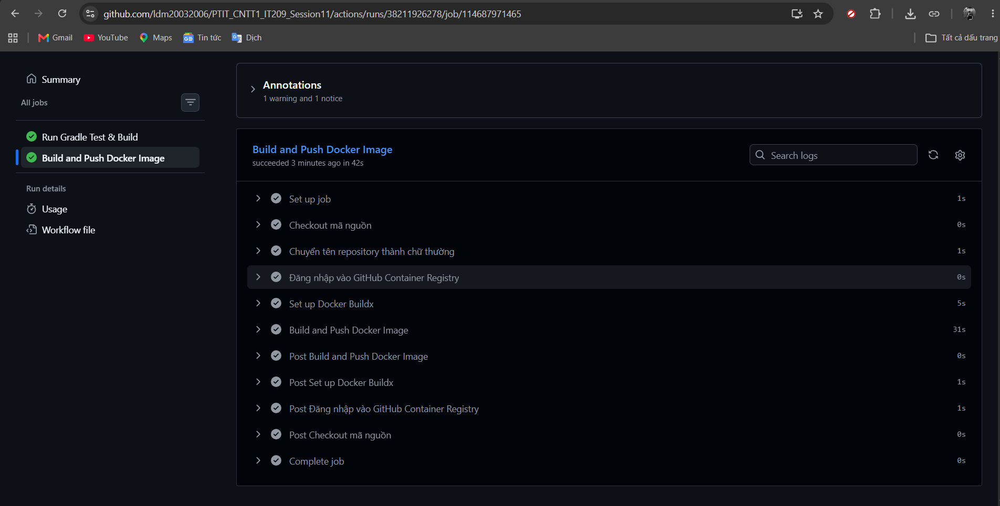
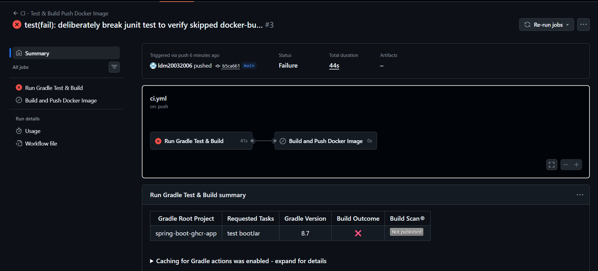

# Bài 5: Nối Job tự động Build & Push Docker Image sau khi Test Gradle xanh

## 1. Mục tiêu bài thực hành
- Tách luồng CI thành 2 Job riêng biệt:
  - **Job `test`**: Thực thi kiểm thử đơn vị JUnit với Gradle và đóng gói JAR.
  - **Job `docker-build`**: Đóng gói Docker Image ứng dụng Spring Boot và đẩy (Push) lên GitHub Container Registry (`ghcr.io`).
- Ràng buộc thứ tự thực thi chặt chẽ bằng từ khóa **`needs: test`** trong Job `docker-build`:
  - Đảm bảo Job `docker-build` **không bao giờ chạy song song** khi chưa kiểm tra trạng thái Job `test`.
  - Chỉ đóng gói và đẩy Docker Image khi bài test Gradle đạt kết quả màu xanh (Success).
  - Tự động bỏ qua (**Skipped**) Job `docker-build` nếu bài test Gradle bị đứt (Failed).

---

## 2. Danh mục sản phẩm bàn giao (Deliverables)

| STT | Thành phần bàn giao | Đường dẫn tệp | Mô tả |
|---|---|---|---|
| 1 | Kịch bản CI 2 Job (`needs: test`) | `.github/workflows/ci.yml` | Tệp kịch bản tại root và `homework/session_11/ex5/.github/workflows/ci.yml` |
| 2 | Dockerfile ứng dụng Spring Boot | `Dockerfile` | Multi-stage build (Gradle 8.7 JDK 17 & JRE 17 Alpine) |
| 3 | Mã nguồn Spring Boot Gradle | `src/`, `build.gradle`, `settings.gradle` | Ứng dụng Spring Boot hoàn chỉnh kèm JUnit test |
| 4 | Ảnh biểu đồ 2 Job nối nhau thành công | `screenshots/workflow_graph_success.png` | Ảnh sơ đồ tab Actions có mũi tên `test` ➔ `docker-build` |
| 5 | Ảnh Job `docker-build` bị Skipped | `screenshots/workflow_graph_skipped.png` | Minh chứng khi làm đứt test, Job `docker-build` chuyển sang `Skipped` |

---

## 3. Kiến trúc sơ đồ Workflow (Job Dependency Graph)

### Kịch bản 1: Khi Test Gradle xanh (Thành công)


### Kịch bản 2: Khi Test Gradle đứt (Thất bại)


---

## 4. Chi tiết kịch bản `.github/workflows/ci.yml`

```yaml
name: CI - Test & Build Push Docker Image

on:
  push:
    branches:
      - main
  pull_request:
    branches:
      - main
  workflow_dispatch:

jobs:
  # ==========================================
  # JOB 1: TEST GRADLE
  # ==========================================
  test:
    name: Run Gradle Test & Build
    runs-on: ubuntu-latest

    steps:
      - name: Checkout source code
        uses: actions/checkout@v4

      - name: Set up JDK 17
        uses: actions/setup-java@v4
        with:
          java-version: '17'
          distribution: 'temurin'

      - name: Setup Gradle
        uses: gradle/actions/setup-gradle@v3

      - name: Grant execute permission for gradlew
        run: chmod +x gradlew || true

      - name: Chạy Gradle test & đóng gói JAR
        run: gradle test bootJar --no-daemon

  # ==========================================
  # JOB 2: DOCKER BUILD & PUSH (NEEDS: TEST)
  # ==========================================
  docker-build:
    name: Build and Push Docker Image
    needs: test # Ràng buộc: Chỉ chạy khi job test hoàn thành màu xanh; Bị Skipped nếu test đứt
    runs-on: ubuntu-latest
    permissions:
      contents: read
      packages: write

    steps:
      - name: Checkout mã nguồn
        uses: actions/checkout@v4

      - name: Chuyển tên repository thành chữ thường
        id: string
        run: |
          echo "repo=${GITHUB_REPOSITORY,,}" >> $GITHUB_OUTPUT

      - name: Đăng nhập vào GitHub Container Registry
        uses: docker/login-action@v3
        with:
          registry: ghcr.io
          username: ${{ github.actor }}
          password: ${{ secrets.REGISTRY_TOKEN }}

      - name: Set up Docker Buildx
        uses: docker/setup-buildx-action@v3

      - name: Build and Push Docker Image
        uses: docker/build-push-action@v5
        with:
          context: .
          file: ./Dockerfile
          push: true
          tags: |
            ghcr.io/${{ steps.string.outputs.repo }}:latest
            ghcr.io/${{ steps.string.outputs.repo }}:${{ github.sha }}
```

---

## 5. Cấu hình Dockerfile Multi-stage

Tệp `Dockerfile` tối ưu hóa kích thước và thời gian build:
```dockerfile
# Stage 1: Build JAR package using Gradle
FROM gradle:8.7-jdk17-alpine AS builder
WORKDIR /app

# Copy dependency specifications and source code
COPY build.gradle settings.gradle ./
COPY src src

# Build executable bootJar
RUN gradle bootJar --no-daemon

# Stage 2: Minimal JRE runtime
FROM eclipse-temurin:17-jre-alpine
WORKDIR /app

# Copy packaged JAR from builder stage
COPY --from=builder /app/build/libs/*.jar app.jar

EXPOSE 8080
ENTRYPOINT ["java", "-jar", "app.jar"]
```

---

## 6. Hướng dẫn kiểm tra và lấy ảnh minh chứng nộp bài

### Bước 1: Đẩy mã nguồn & Chụp ảnh sơ đồ liên kết 2 Job thành công
1. Đẩy code lên GitHub:
   ```bash
   git add .
   git commit -m "feat(b5): implement 2-job CI pipeline with needs constraint and Docker build-push"
   git push origin main
   ```
2. Vào tab **Actions** trên GitHub, bấm vào lần chạy workflow **CI - Test & Build Push Docker Image**.
3. Bạn sẽ thấy biểu đồ trực quan có **mũi tên nối từ Job `Run Gradle Test & Build` sang Job `Build and Push Docker Image`**.
4. Cả 2 job đều hiện màu xanh lá cây (Success).
5. **Chụp ảnh màn hình sơ đồ này** và lưu vào:
   `b5/screenshots/workflow_graph_success.png` (và `homework/session_11/ex5/screenshots/workflow_graph_success.png`).

---

### Bước 2: Kiểm tra kịch bản làm đứt Test (Kiểm chứng `docker-build` bị Skipped)
1. Mở file test: [`src/test/java/com/example/demo/DemoApplicationTests.java`](file:///d:/IT209/Session11/PTIT_IT209_Session11/src/test/java/com/example/demo/DemoApplicationTests.java).
2. Thêm hoặc bỏ comment dòng `Assertions.fail()`:
   ```java
   @Test
   void contextLoads() {
       org.junit.jupiter.api.Assertions.fail("Cố tình làm đứt JUnit Test để kiểm tra Job docker-build bị Skipped");
   }
   ```
3. Commit và push:
   ```bash
   git add src/test/java/com/example/demo/DemoApplicationTests.java
   git commit -m "test(fail): deliberately break junit test to verify skipped docker-build"
   git push origin main
   ```
4. Vào tab **Actions**:
   - Job **`test`** hiển thị màu đỏ (Failed ❌).
   - Job **`docker-build`** hiển thị màu xám/vòng tròn gạch ngang (**Skipped ⚪**) vì điều kiện `needs: test` không thỏa mãn.
5. **Chụp ảnh màn hình trạng thái Skipped này** và lưu vào:
   `b5/screenshots/workflow_graph_skipped.png` (và `homework/session_11/ex5/screenshots/workflow_graph_skipped.png`).
6. Khôi phục lại bài test (xóa dòng `Assertions.fail()`) và push lại để workflow trở về màu xanh hoàn chỉnh!

---

## 7. Minh chứng ảnh chụp sản phẩm bàn giao

### Minh chứng 1: Biểu đồ Workflow 2 Job nối nhau qua `needs: test` (Thành công)


---

### Minh chứng 2: Trạng thái Job `docker-build` tự động Skipped khi Test đứt

